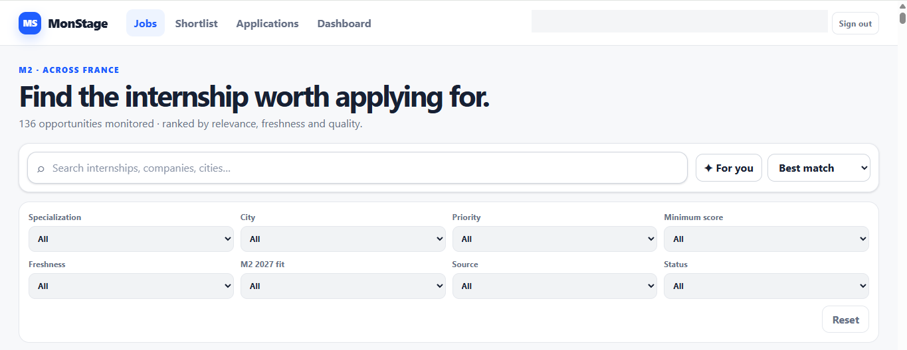

<h1 align="center">MonStage</h1>

**MonStage** is a private, responsive internship intelligence and application operating system built on top of the existing **Stage Intelligence France** data source. It turns a private Google Sheet into a modern job-board experience optimized for desktop and mobile while keeping runtime access restricted to one authorized Google account.

## Product preview



*Authenticated Jobs view — internship discovery, relevance ranking, search, and multi-criteria filtering across France. The live workspace remains intentionally restricted; the preview is sanitized for public display.*

**Live app:** [Open MonStage](https://denoskume.github.io/monstage/) *(restricted access)*

## Focus transport 2027 · 15 entreprises, deux plans

MonStage se concentre sur **exactement quinze grands groupes présents en France dans le transport**, avec les **mêmes quinze** dans les deux parcours.

| Secteur (5 groupes chacun) | Employeurs |
| --- | --- |
| Aéronautique et transport aérien | Airbus, Safran, Thales, Dassault Aviation, Air France-KLM |
| Ferroviaire et transport public | Alstom, SNCF, RATP, Siemens Mobility, Hitachi Rail |
| Automobile et équipementiers | Renault Group, Stellantis, Valeo, FORVIA/HELLA, Michelin |

- **Plan A (prioritaire)** : Computer Vision / traitement d'images, inspection visuelle, vision industrielle, segmentation, contrôle qualité et ML exclusivement appliqué aux images.
- **Plan B** : **Data Analyst uniquement** ; SQL, Power BI, Business Intelligence, reporting, KPI, analyse des opérations, maintenance, fiabilité et données industrielles. Exclure Data Scientist, Data Engineer, finance et conseil non technique.
- **Un groupe = un dossier entreprise, pas une seule candidature.** Un même groupe peut recevoir différentes candidatures adaptées Plan A et Plan B. Les doublons concernent l'offre exacte, pas l'entreprise ; conserver pour chaque poste son lien, son état, ses documents et ses dates.
- **Préparer les appels** : les quinze fiches regroupent postes visés, statuts et notes de contacts/équipes. Identifier immédiatement l'entreprise et le contexte lorsqu'un recruteur appelle ; ne jamais inventer de contact ou de démarche.
- Stage Master 2 d'environ six mois, début janvier/février 2027, Nantes en priorité, mobilité France. Les missions clairement liées à la défense, académiques/hors domaine et les postes financiers sont exclus.
- **Préservation des archives** : les offres hors des quinze entreprises ne sont plus proposées dans la prospection active, mais les anciens dossiers, statuts et documents ne sont pas effacés par ce filtrage.

La règle commune est définie dans `shared/searchScope.ts`. Le frontend, le Worker et Apps Script la respectent. L'absence de résultat dans un portail ne prouve pas l'absence d'une opportunité dans une entreprise.

## Product flow

**Discover → Evaluate → Prioritize → Prepare → Apply → Follow up → Interview → Learn**

MonStage is intentionally candidate-first. It does not try to reproduce employer-side ATS, job advertising, sponsorship, or recruiter sourcing features.

## What it includes

- Google Sign-In gate for one authorized account
- Job-board style offers list with desktop split view
- Mobile one-column browsing and dedicated offer detail
- Search, filters, sorting, and personalized ranking
- Shortlist view
- Application pipeline view
- **Application Workspace** for each priority opportunity
- **Personalized CV match** against the candidate's current technical profile
- **Application package checklist**: tailored CV, cover letter/message, interview prep, submission
- **Follow-up intelligence** with recommended timing
- **Company / role intelligence** grounded in the monitored offer data
- **Private per-offer notes** stored only in the authenticated browser
- Compact decision dashboard
- **Outcome analytics**: response, interview, and offer conversion rates
- Responsive layouts from **360px** through large desktop screens
- Structural dark-mode support

## Architecture

```text
GitHub Pages — React / TypeScript / Vite
        |
        | Google Identity Services ID token
        v
Cloudflare Worker — authentication + authorization gateway
        |
        | server-only POST + gateway secret
        v
Google Apps Script Web App
        |
        v
Private Google Sheet — Stage Intelligence France
```

The browser never calls Apps Script directly in production. The Cloudflare Worker verifies the Google ID token, checks the configured single-user allowlist, and only then proxies a sanitized offers request to Apps Script. Direct Apps Script GET access returns no internship data.

Application Workspace notes and package readiness are stored locally in the authenticated browser. The public frontend does **not** receive credentials for private GitHub repositories such as application document archives.

## Security model

The public repository contains frontend and Worker source code, but no private runtime credentials.

Never commit:

- private spreadsheet IDs
- the authorized Google email address
- Apps Script deployment URLs used by the Worker
- `MONSTAGE_GATEWAY_SECRET` / `APPS_SCRIPT_GATEWAY_SECRET`
- Cloudflare API tokens
- Google OAuth client secrets
- bearer tokens
- `.env.local`
- private notes from `Notes / stratégie`

Public configuration may include:

- the Google OAuth **Web Client ID**
- the public Cloudflare Worker origin
- the GitHub Pages origin

The Google OAuth client ID is intentionally public; authorization is enforced server-side by the Worker.

## Local frontend setup

Requirements: Node.js 22+ and npm.

```bash
npm install
cp .env.example .env.local
```

Set public development values in `.env.local`:

```bash
VITE_GOOGLE_CLIENT_ID=YOUR_WEB_CLIENT_ID.apps.googleusercontent.com
VITE_MONSTAGE_API_URL=https://YOUR_WORKER.workers.dev
```

Then run:

```bash
npm run dev
```

## Cloudflare Worker

Worker source lives in `worker/`.

```bash
npm --prefix worker install
npm run test:worker
npm run typecheck:worker
```

Worker configuration:

Public/non-secret bindings:

- `GOOGLE_CLIENT_ID`
- `ALLOWED_ORIGINS`

Worker secrets:

- `ALLOWED_EMAIL`
- `APPS_SCRIPT_URL`
- `APPS_SCRIPT_GATEWAY_SECRET`

Deploy with Wrangler after configuring the bindings and secrets.

## Google Apps Script backend

See [`apps-script/README.md`](apps-script/README.md) for deployment instructions.

Required Script Properties:

- `SPREADSHEET_ID`
- `MONSTAGE_GATEWAY_SECRET`

`MONSTAGE_GATEWAY_SECRET` must match the Worker secret `APPS_SCRIPT_GATEWAY_SECRET`. Apps Script serves offers only from a secret-gated POST request. Its direct GET endpoint returns no offers.

## Tests

```bash
npm test
npm run test:worker
npm run typecheck:worker
npm run build
npm run test:e2e
```

The E2E suite covers desktop Chrome, mobile Chrome, and a 360×800 viewport, including authentication and horizontal-overflow checks.

## Deployment

GitHub Pages deploys from `main` through `.github/workflows/deploy-pages.yml`.

Repository setting required once:

- **Settings → Pages → Build and deployment → Source: GitHub Actions**

Public GitHub Actions repository variables required:

- `VITE_GOOGLE_CLIENT_ID` → Google OAuth Web Client ID
- `VITE_MONSTAGE_API_URL` → public Cloudflare Worker origin

The workflow explicitly rejects an Apps Script URL as `VITE_MONSTAGE_API_URL` and scans the production bundle for protected values before deployment.

The Vite base path is `/monstage/`, and client routing uses `HashRouter` so direct navigation does not produce GitHub Pages 404 errors.

## Product name

**MonStage — Internship Intelligence & Application OS**
